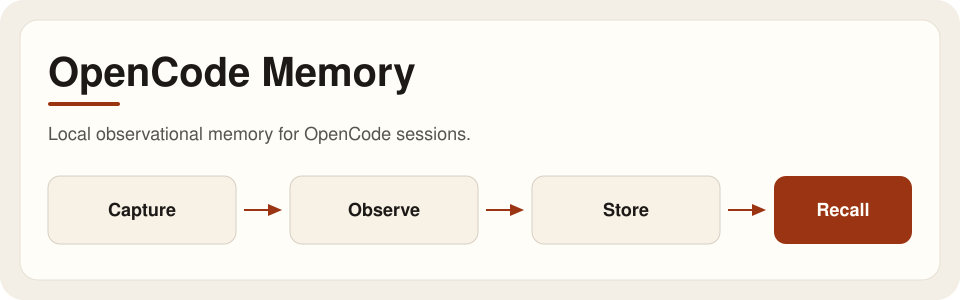
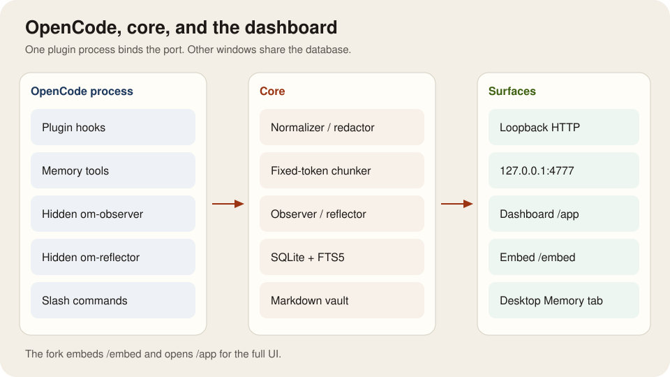
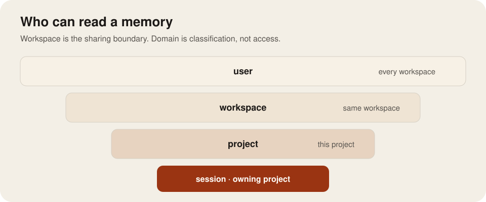
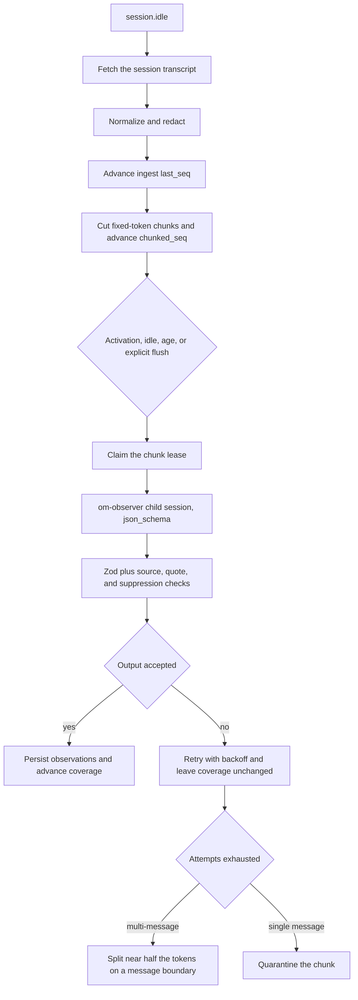
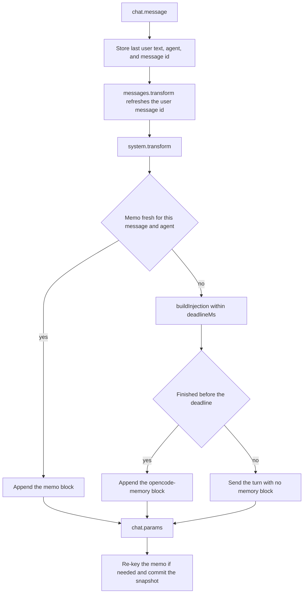
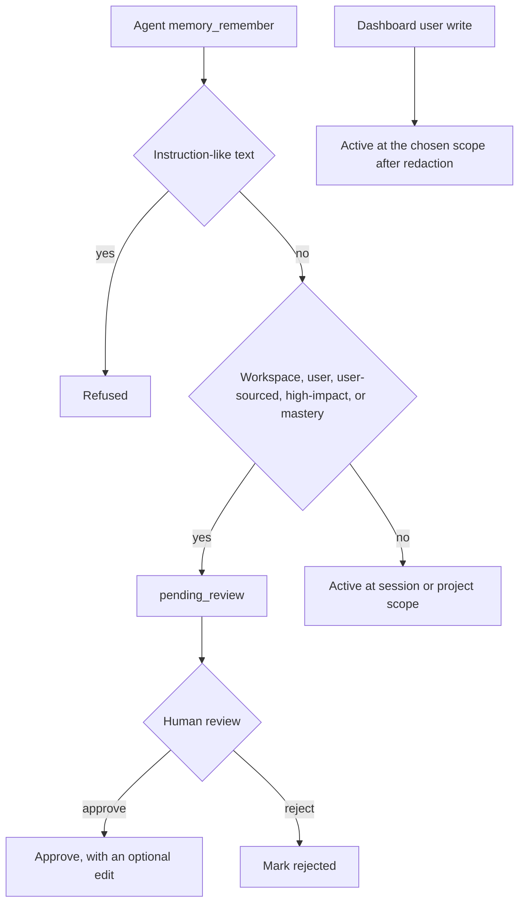

# OpenCode Memory

<p align="center">
  <picture>
    <source media="(prefers-color-scheme: dark)" srcset="docs/assets/hero-dark.svg">
    
  </picture>
</p>

Local observational memory for OpenCode sessions. The plugin retains a redacted source snapshot, asks an observer model to extract attributable observations, retrieves relevant memory into later turns, and gives the user a reviewable dashboard. Learning and research are the first domain-specific workflows; this is not a remote knowledge service or a guarantee that model-generated observations are true.

## What is implemented

- Session capture with configurable reasoning/tool-output limits and secret redaction.
- Observations at session, project, workspace, and user scopes, with source ranges and exact recall of the retained, redacted snapshot.
- Automatic prompt injection, optional message pruning, background observation/reflection, cost caps, retries, and pause controls.
- Human review for agent proposals that would become shared or high-impact memory.
- Learning concepts, quiz/retention attempts, and FSRS review scheduling.
- Research claims, sources, supporting/contradicting evidence, and conflict reports.
- SVG/Mermaid artifact indexing and sanitized dashboard rendering.
- SQLite storage, generated Markdown vault notes, JSON export, and scrub-aware SQLite backups.
- A full browser dashboard at `http://127.0.0.1:4777/app` and an `/embed` view used by the optional desktop fork's Memory tab.

## Boundaries

Current boundaries: learning and research state is workspace-wide rather than project-specific; embeddings are optional and off by default; the dashboard exists only while a plugin process owns the loopback port; the desktop fork is a thin, separately built integration. See [known limitations](docs/development.md#known-limitations).

## Architecture

The OpenCode plugin captures lifecycle events and exposes memory tools. The Node-compatible core owns policy, SQLite, retrieval, review, learning/research, the vault, and backups. One plugin process binds `127.0.0.1`; other OpenCode windows share the database and route long-running commands through it. The dashboard is bundled into the plugin. The desktop fork only embeds `/embed`, passes session context over a constrained `postMessage` bridge, and opens `/app` for the complete UI.

<p align="center">
  <picture>
    <source media="(prefers-color-scheme: dark)" srcset="docs/assets/architecture-dark.svg">
    
  </picture>
</p>

<p align="center">
  <picture>
    <source media="(prefers-color-scheme: dark)" srcset="docs/assets/scopes-dark.svg">
    
  </picture>
</p>

Session rows are readable within the owning project. User and observer session rows can be shared across that project's sessions; an unreviewed direct agent write is readable only in its own session. Project rows stay in that project. Workspace rows are readable by projects assigned to the same workspace. User rows are readable in every workspace. Pending-review observations are readable only from their originating session. Source recall is narrower than observation visibility: a user-scoped fact from another workspace can be readable while its source stays hidden.

See [Architecture, data, and security](docs/architecture-security.md) for the component flow, scope rules, trust boundaries, and forget semantics. See [Implementation report](docs/implementation.md) for how those pieces were built.

### Observation pipeline

`session.idle` fetches the session transcript and ingests it. Capture advances `ingest_state.last_seq`. Fixed-token chunks advance `chunked_seq` separately. Coverage advances only when a chunk is observed successfully. Automatic model work waits for `observe.activationTokens` (default 30,000). Idle (90s), max unobserved age (10 minutes), startup recovery, and explicit flush still process smaller sessions. The hidden `om-observer` child session must return JSON Schema output; Zod then checks source refs, verbatim quotes, attribution, instruction-like text, and forgotten-content suppressions. Invalid or oversized multi-message chunks are retried, then split at a message boundary nearest half the token mass. A chunk that cannot be split is quarantined. Authentication failure pauses workers. A cost-cap miss does not run the model. There is no separate "not observed" marker: unobserved text simply has no coverage row yet.



### Per-turn injection

`chat.message` records the latest user text, agent, and message id. On each step, `experimental.chat.messages.transform` runs before injection and can refresh that message id; optional pruning of already-covered messages is off by default. `experimental.chat.system.transform` skips internal worker prompts. It reuses `injectionMemo` when the message id, learning-agent override, generation counter, and event watermark still match; otherwise it builds a block inside `inject.deadlineMs` (default 250). A miss sends the turn with no memory block. Two misses in a row skip injection for that session for ten minutes. `chat.params` re-keys the memo when OpenCode's message id differs and commits the snapshot that the dashboard shows.



## Requirements

- [Bun](https://bun.sh/) for dependency installation, builds, typechecks, and tests.
- Node.js 24 for the local installer and the supported `node:sqlite` runtime/checks.
- OpenCode v1.18.32 for desktop-fork integration; the plugin pins `@opencode-ai/plugin` and `@opencode-ai/sdk` exactly to 1.18.32.

The core also detects Bun and uses `bun:sqlite`; otherwise it uses `node:sqlite`.

## Install locally

From this repository:

```sh
bun install
bun run build
node scripts/install-local.mjs
```

The build creates the dashboard and `packages/plugin/dist/index.js`. The installer adds that absolute file URL to OpenCode's `plugin` array, preserves JSONC comments, and backs up an existing config before changing it. Restart OpenCode, open a normal session, and run `/memory-status` or open `http://127.0.0.1:4777/app`.

To update after pulling changes:

```sh
bun install
bun run build
```

Restart OpenCode. Re-run the installer only if the checkout moved or its OpenCode plugin entry was removed.

To unregister the current checkout:

```sh
node scripts/install-local.mjs --uninstall
```

Uninstall does not remove memory data, the memory config, vault, or backups. See [Installation and paths](docs/getting-started.md) for OS-specific locations, environment overrides, updates, and complete removal.

## Configure a project

Optional `.opencode/memory.json`:

```json
{
  "workspace": "personal-knowledge",
  "domain": "learning",
  "name": "Algorithms course",
  "exclude": false
}
```

`domain` is `general`, `learning`, or `research`. The workspace is the cross-project sharing boundary; domain is a classification and controls the focused dashboard cards. Global configuration is JSON at `~/.config/opencode-memory/config.json` by default.

`inject.learningAgents` defaults to `["learn"]`. For those agent names, injection and the learning tools use domain `learning` and workspace `learning`, including due reviews. The project's own workspace is left unchanged.

Start from the safe examples in [Configuration](docs/configuration.md). In particular:

- `runner.kind: "opencode-session"` uses hidden OpenCode child sessions and the configured model, OpenCode `small_model`, or the current session model.
- `runner.kind: "direct"` calls an OpenAI-compatible `/chat/completions` endpoint; keep API keys in an environment variable named by `apiKeyEnv`.
- Embeddings call an OpenAI-compatible `/embeddings` endpoint and send redacted observation text to it. They are disabled by default.
- Add the desktop renderer's exact origin to `allowedOrigins`: `oc://renderer` when packaged, or the exact `http://localhost:<port>` origin used in desktop development.

Never put an API key value in the JSON file or in documentation.

### Injection budget

Each injected section keeps lines only while `used + ceil(characters / 4) <= B_k` (`estimateTokens` in `packages/core/src/util.ts`). Topic lines and workspace observations share `B_workspace`. The `<opencode-memory>` wrapper and headings are outside those caps, so the stored estimate for the whole block can sit a little above the sum. With the defaults in `defaultConfig`:

```math
\sum_k B_k = B_{\mathrm{profile}} + B_{\mathrm{workspace}} + B_{\mathrm{project}} + B_{\mathrm{session}} + B_{\mathrm{task}} + B_{\mathrm{recall}} = 600 + 900 + 900 + 2400 + 300 + 900 = 6000
```

```math
\mathrm{tokens}(S_k) \le B_k
\qquad\Rightarrow\qquad
\sum_k \mathrm{tokens}(S_k) \le 6000
```

### Retrieval score

Search is in `packages/core/src/retrieval.ts`. When FTS5 is available, the text raw score is the negation of SQLite `bm25(observations_fts)` called with no extra arguments, so FTS5's defaults $k_1 = 1.2$ and $b = 0.75$ apply. FTS5 returns a non-positive rank (more negative is better). If FTS5 is missing, the in-process fallback uses the same constants and prefix term matches:

```math
\mathrm{idf}(t) = \ln\left(1 + \frac{N - n_t + 0.5}{n_t + 0.5}\right)
```

```math
\mathrm{BM25}(D, Q) = \sum_{t \in Q} \mathrm{idf}(t) \cdot \frac{\mathrm{tf}_t (k_1 + 1)}{\mathrm{tf}_t + k_1 \left(1 - b + b \frac{|D|}{\mathrm{avgdl}}\right)}
```

Text raw scores are divided by the max raw score in the candidate set. Optional embeddings (off by default) keep a row only when cosine similarity is above $0.25$. If any vector hit exists, text and vector are fused; otherwise the text score stands alone:

```math
\mathrm{base} =
\begin{cases}
0.6\, t + 0.4\, v & \text{if any vector candidate exists} \\
t & \text{otherwise}
\end{cases}
```

Freshness $F$ is $1$ for a pinned row or a stable kind (preference, learning-preference, personal-fact, goal, decision, prior-knowledge, demonstrated-skill, conclusion, condensed). Otherwise, with age $a$ and half-life $h$ ($7$ days for `task-state` and `tool-outcome`, else $45$ days):

```math
F = 0.35 + 0.65 \cdot 2^{-a/h}
```

The additive boost $\beta$, before it is multiplied by $F$, starts at $0.1$ times confidence, then adds $0.06$ for high priority or subtracts $0.03$ for low, adds $0.12$ if pinned, adds $0.05$ for the same session or else $0.03$ for the same project, adds $0.03$ for explicit, quiz, or source evidence, subtracts $0.05$ if the row came from recall, and subtracts $0.2$ if superseded. The sort key is:

```math
\mathrm{score} = \mathrm{base} \cdot F + \beta \cdot F
```

## Use it

OpenCode commands added by the plugin:

- `/remember …` — ask the agent to call `memory_remember`.
- `/recall …` — search observations, then recall retained source.
- `/memory-status` — show capture, observer, SQLite/FTS, and review status.
- `/review-due` — list learning concepts due for review.
- `/claims …` — list research claims and conflicts.

The Memory tab in the desktop fork shows this session's status, injected context, review queue, learning/research cards, timeline, search/recall, and Remember/Flush/Pause actions. Source links navigate back to the originating message. The full `/app` dashboard adds cross-session search, topic generations, learning, research, artifacts, runs, settings, backup/restore/export, and session controls.

User-authored dashboard writes may enter shared scopes directly. Agent-authored shared/high-impact writes wait for review; the observer's scope placement is also constrained by evidence and attribution. Agent forget asks permission and is scope-bounded. Dashboard forget is a confirmed user action and globally suppresses selected content.

An agent `memory_remember` that is instruction-like is refused. A proposal aimed at workspace or user scope, or a user-sourced, high-impact, or mastery kind, is stored as `pending_review` (session scope when a session exists, otherwise project) until approve, edit, or reject. Other agent writes can be active only at session or project scope. Dashboard user writes are redacted and can be active at the chosen scope. Approve can replace the text; reject marks the row rejected.



FSRS schedules recall practice only. Mastery levels are a separate evidence model in `packages/core/src/learning.ts`. The scheduler is `ts-fsrs` `5.4.2` (`^5.2.0` in `packages/core/package.json`, resolved in `bun.lock`), called as `fsrs({ enable_fuzz: false })`. That release implements FSRS-6.0, not the fixed FSRS-4.5/5 curve. Retrievability uses a trainable decay $w_{20}$ (default $0.1542$):

```math
D = -w_{20}
\qquad
F = 0.9^{1/D} - 1
\qquad
R(t, S) = \left(1 + F \frac{t}{S}\right)^{D}
```

The library rounds $F$ and $R$ to 8 decimal places. Grades passed into `scheduler.next` are Again for an incorrect attempt, Hard for a partial or assisted attempt, and Good otherwise. The fixed FSRS-4.5/5 constants $F = 19/81$ and $D = -0.5$ are not what this dependency uses.

See [User guide](docs/user-guide.md).

## Documentation

- [Installation, updates, uninstall, and paths](docs/getting-started.md)
- [Configuration reference and safe examples](docs/configuration.md)
- [Memory tab and dashboard user guide](docs/user-guide.md)
- [Architecture, data model, scopes, security, and privacy](docs/architecture-security.md)
- [How it was implemented (pipelines, hooks, storage, fork)](docs/implementation.md)
- [Troubleshooting](docs/troubleshooting.md)
- [Development, desktop fork, contribution, and release readiness](docs/development.md)
- [Complete project and feature guide (PDF)](docs/OpenCode-Memory-Project-Documentation.pdf)
- [Complete project and feature guide (Word)](docs/OpenCode-Memory-Project-Documentation.docx)

## Verify the workspace

```sh
bun run build
bun run typecheck
bun run --cwd packages/dashboard typecheck
bun test packages/core packages/plugin packages/evals
bun test packages/dashboard/test
bun run test:node:core
bun run test:node
```

`test:node` consumes the built plugin, so run `bun run build` first. Hermetic acceptance coverage lives in `packages/evals/test`. `bun run eval:real -- --dry-run` validates the opt-in real-provider eval without making a network/model call; a live run requires explicit confirmation, a running OpenCode server, and a cost cap. See [Development](docs/development.md#evaluations).

Contributor commands, the package map, desktop checks, rebase workflow, and safety checklist are in [Development](docs/development.md).

## Security summary

The HTTP server binds only `127.0.0.1`, checks `Host` and `Origin`, rejects CORS preflights, requires `X-OM-Token` for `/api/*`, and serves token-bearing HTML with no-store and a restrictive CSP. Capture and vault writes redact known secret formats. Agent and user actions have different trust and scope rules.

These are defense-in-depth controls, not a sandbox: a process running as the same OS user can read local files or fetch `/app` and recover its embedded token; pattern-based redaction can miss secrets; configured model/embedding endpoints receive redacted text; and backup erasure can remain pending after forget. Read the complete [security and privacy model](docs/architecture-security.md#security-and-privacy-invariants) before using sensitive material.
