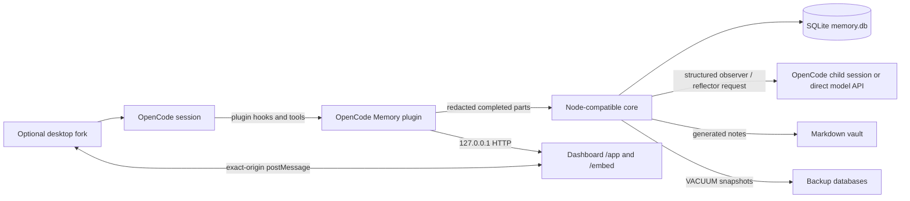

# Architecture, data, and security

## Component flow

### Plugin

`packages/plugin` registers:

- session/message lifecycle capture;
- system-prompt memory injection;
- compaction context and optional covered-message pruning;
- hidden `om-observer` and `om-reflector` agents;
- memory, learning, research, and artifact tools;
- slash-command templates;
- the loopback dashboard/API server.

A process-global service prevents duplicate engines inside one OpenCode process. Multiple processes coordinate through SQLite instance heartbeats, leases, jobs, and routed commands.

### Core

`packages/core` is runtime-neutral TypeScript. It uses `bun:sqlite` under Bun and `node:sqlite` otherwise. It owns normalization, redaction, ingestion, chunking, model-run accounting, observation validation, scopes, retrieval/injection, lifecycle, reflection, vault materialization, domain projections, forgetting, and backup/restore.

SQLite uses WAL, an 8-second busy timeout, `foreign_keys`, `secure_delete`, `synchronous=NORMAL`, and FTS5 when available. FTS5 absence degrades search to in-process BM25.

### HTTP and dashboard

One process binds `127.0.0.1:<port>`. If the port already serves an `opencode-memory` health response, later processes share the database/server; otherwise they warn and retry the bind every 30 seconds. Dashboard actions needing a live OpenCode adapter are executed locally or queued to the instance owning the project directory.

The bundled Solid dashboard serves:

- `/embed` for the in-session tab;
- `/app` and `/app/*` for the complete UI;
- `/assets/*` for static bundles;
- `/api/*` for authenticated data/actions;
- `/health` for an unauthenticated, data-free compatibility probe.

### Desktop fork

The sibling OpenCode fork is a thin host. It accepts dashboard URLs only over HTTP(S) with the exact hostname `127.0.0.1` or `localhost`, probes `/health`, embeds `/embed` in a sandboxed iframe, and exchanges versioned context/actions over `postMessage`. Both sides verify `event.source`, exact `event.origin`, and an exact target origin.

The host limits insertion to 16,000 characters, appends rather than replaces, switches the composer to normal mode, does not submit, validates source-navigation IDs, restricts dashboard paths to `/app`, and rate-limits dashboard opens. Action messages are honored only while the Memory tab is active and its iframe has focus.

The packaged renderer is `oc://renderer`. Development loads `ELECTRON_RENDERER_URL`, normally a localhost origin. Both the plugin's `allowedOrigins` and the Electron renderer CSP must permit the embedding relationship; the fork CSP permits HTTP(S) frames only for the IPv4 loopback hostnames `127.0.0.1` and `localhost`. The plugin server binds IPv4 `127.0.0.1`.

### Vault and backups

Reflection operates on project/workspace durable observations. It may create/merge topic generations, condense observations, supersede stale facts, append journey entries, or propose promotion. Topic bullets cite observation IDs.

The vault is an asynchronous projection, not the source of truth:

- workspace `INDEX.md` and `JOURNEY.md`;
- topic Markdown beneath workspace/project scope folders;
- front matter with topic ID, generation, and body hash.

External changes open a conflict instead of being overwritten. Forget can force a sanitized rewrite/delete. Stored paths are checked lexically and after symlink/junction resolution; UNC/device paths and escapes are refused.

Backups are marked SQLite snapshots made with `VACUUM INTO`. Restore intersects columns with the live schema, keeps live operational tables/connections, merges suppressions, re-applies forget, and rebuilds derived indexes.

## Data model

The schema is converged on each open. Important groups:

- Identity: `projects`, `sessions`, `fork_map`, `instances`.
- Retained source: `source_messages`, `source_parts`, `ingest_state`.
- Observation pipeline: `chunks`, `coverage`, `observations`, `observation_sources`, `observation_events`, `session_state`.
- Review and lifecycle: `review_items`, `suppressions`, `suppression_shingles`, `context_snapshots`.
- Work coordination/accounting: `jobs`, `commands`, `operations`, `runtime_state`.
- Reflection/vault: `reflections`, `topics`, `topic_generations`, `vault_outbox`, `journey_entries`.
- Retrieval: `observations_fts` when FTS5 exists, plus `embeddings`.
- Learning: `learning_concepts`, `learning_attempts`, `review_cards`.
- Research: `research_sources`, `research_claims`, `claim_evidence`.
- Artifacts: `artifacts`.

Source rows store redacted text, hashes, sequence/order, omissions, and status. Observations store normalized content, kind/domain, confidence/evidence, scope, lifecycle, payload, actor, and source links. Events are append-only, but event data is cleared when an observation is forgotten.

## Scopes and access

The workspace is the sharing boundary. Domain (`general`, `learning`, `research`) is classification, not access control.

- `session`: readable within the owning project. User/observer rows can be shared across that project's sessions; an unreviewed direct agent write is readable only in its own session.
- `project`: readable only in that project.
- `workspace`: readable by projects assigned to the same workspace.
- `user`: readable in every workspace.

Pending-review observations are readable only from their originating session. Injection, agent tools, search, list, source recall, review narrowing, promotion, and scoped forget use the central scope policy.

Source visibility is narrower than memory visibility:

- source in the same project is recallable;
- a workspace observation can expose source from another project only inside the same workspace;
- a user observation from another workspace exposes the observation, not its source.

The authenticated dashboard is the user's global UI and has endpoints that list all data. Possession of the dashboard token therefore represents user-level trust, not agent-level scope.

### User versus agent writes

Dashboard/API user writes can directly create any scope and have explicit evidence/confidence. Agent direct writes:

- are refused when instruction-like text could steer future sessions without a user source;
- remain active only at session/project scope;
- place workspace/user proposals in pending review;
- place user-sourced/high-impact/mastery items in review;
- cannot supersede shared memories or pending-review rows.

Observer output is additionally validated against real chunk refs, verbatim quotations, user attribution, current suppressions, and domain payloads. Reflector operations must cite live input observations and cannot make mastery assertions.

## Security and privacy invariants

### Loopback HTTP

- The server listens on IPv4 `127.0.0.1` only.
- `Host` must be exactly `127.0.0.1:<configured-port>` or `localhost:<configured-port>`. This is the DNS-rebinding guard.
- An `Origin`, when present, must be the server origin or an exact `allowedOrigins` entry.
- A request with no Origin and `Sec-Fetch-Site: cross-site` is rejected, except a GET navigation to `/app`, `/app/*`, or `/embed`.
- `/api/*` requires `X-OM-Token`; comparison is timing-safe.
- CORS preflight is rejected. `/api` never emits permissive CORS headers. `/health` emits `Access-Control-Allow-Origin` only for an allowed origin and contains no user data.
- POST mutations require `application/json` and an object body. Bodies over 1 MB are rejected and the connection is closed.
- Destructive forget/session-restore routes require `confirm: true`.

Token-bearing HTML is served with `Cache-Control: no-store`, `Referrer-Policy: no-referrer`, `X-Content-Type-Options: nosniff`, and a CSP restricting default/script/image/style sources and `frame-ancestors`. The token and served config are injected as escaped meta values.

The token is generated from 32 random bytes and stored at `<dataDir>/token`. It prevents unrelated web origins from using the API; it is not protection from local processes running as the same user. Any such process can read the token or request `/app` and parse the embedded token. Do not expose the port through a proxy, container bridge, port-forward, or remote desktop URL.

### Redaction and outbound data

Redaction runs before source storage, direct writes, artifact storage, vault sanitization, and user-visible runner errors. Rules cover common private keys, cloud/API tokens, JWT/bearer values, URL credentials, secret-like assignments, and high-entropy candidates.

Redaction is heuristic:

- novel/short/formatted secrets may pass;
- ordinary high-entropy text may be redacted;
- already sent model-provider data cannot be withdrawn;
- file paths and non-secret personal data are not generally removed.

Observer/reflector requests contain bounded redacted source/observation text. With `opencode-session`, that text goes through the configured OpenCode provider. With `direct`, it goes to the configured chat endpoint. Optional embeddings send redacted observation/query text to the configured embedding endpoint.

Use the dashboard redaction test before processing a sensitive format, but do not treat a passing sample as a guarantee.

### Worker permissions

Hidden `om-*` workers deny every tool except `StructuredOutput`. User configuration may narrow them further with denies but cannot widen them. Primary agents are denied task delegation to `om-*` unless the user explicitly configured that route.

`memory_forget` defaults to OpenCode's `ask` action unless the user supplied a specific rule. Existing explicit deny/ask/allow rules retain last-match semantics.

### Forget invariants

Forget replaces observation/source text with markers rather than keeping deleted plaintext in lifecycle rows. It records content/observation/part/message/session suppressions; text suppressions store hashes and shingles, not forgotten text.

The operation expands through defined provenance relationships:

- predecessors are forgotten, but a successor is not implicitly forgotten;
- a source removes condensed summaries built from it;
- explicitly selecting a condensed summary also removes its direct sources;
- fork copies are followed through recorded message/part lineage;
- scoped agent forget never crosses its stored project/workspace boundary;
- dashboard user forget admits IDs through the selected view but applies globally.

Derived learning/research records, artifacts, embeddings, review data, context snapshots, topic generations, journey entries, FTS tokens, and vault output are scrubbed or rebuilt. Restore always re-applies suppressions.

After commit, old bytes may temporarily remain:

- in SQLite WAL until a successful truncate checkpoint;
- in the vault until forced rewrite/delete succeeds;
- in backups until background scrub completes.

Pending markers survive restart and maintenance retries with backoff. External exports, filesystem/cloud snapshots, copied vaults/backups, and provider logs are outside the scrubber.

### Filesystem limitations

POSIX permissions are best-effort and skipped when ownership/parent safety is unclear. Windows relies on ACLs. SQLite, token, vault, and backups are not encrypted by this project. Vault/artifact path checks reduce accidental or model-driven path escape but do not make the plugin a process sandbox.

## Failure posture

- Invalid model output is dropped/retried/quarantined; it is not silently treated as trusted memory.
- Authentication failures pause model workers until credentials are fixed and the user resumes.
- Cost caps reserve budget before a run.
- Injection failure/deadline miss sends the turn without memory rather than blocking chat.
- Unknown/internal server errors return generic messages; absolute paths are scrubbed from known user-facing errors.
- A refused restore leaves the live database unchanged.
